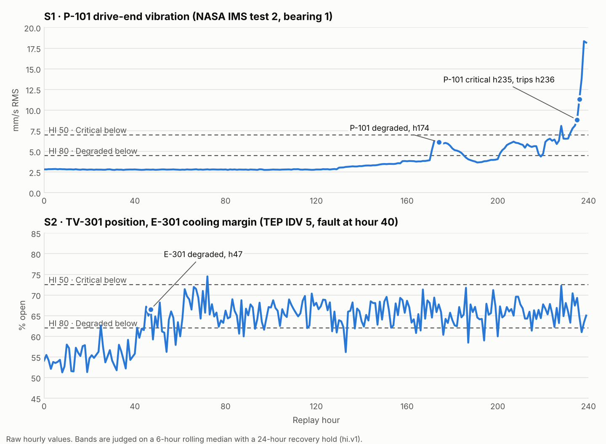

# SafeLoop AI MVP: demo data package

Everything the SafeLoop MVP backend needs to run the demo: real sensor data from two open datasets replayed onto a fictional unit, a labelled synthetic plant model, HAZOP register, document corpus, golden evaluation sets, seed SQL and front-end fixtures. All of it is cross-checked by `tools/validate.py` (562 checks) and rebuilds byte for byte from the open sources.



## What happens in each scenario

The reference engine (`tools/reference_engine.py`) applies the tech spec's health model `hi.v1` and rule set `v1` to the replay files. Your backend should produce the same events; `data/replay/scenarios.json` lists them as a test oracle.

| Scenario | Replay hour | Event | Effect on the HAZOP register |
| --- | --- | --- | --- |
| S1 · P-101 bearing (NASA IMS test 2) | 174 | P-101 Healthy → Degraded, HI 66, vibration 6.1 mm/s | HZ-N1-003 8 → 12 (Medium → High); HZ-N1-005 3 → 6 (Low → Medium); rule R-L-01 |
| | 235 | P-101 Degraded → Critical, HI 44 | HZ-N1-003 12 → 16 (Extreme); HZ-N1-005 6 → 9; rule R-L-02 |
| | 236 | P-101 trips (vibration ≥ 11.2 mm/s); P-101B takes over | — |
| S2 · E-301 cooling (TEP IDV 5) | 40 | Cooling-water supply temperature steps up (fault onset) | — |
| | 47 | E-301 Healthy → Degraded, HI 76, TV-301 66.5% open | HZ-N2-001 6 → 12 (R-L-01, and R-S-01 removes the TIC-301 loop's credit); HZ-N2-002 5 → 10 |

At 8× (2 s per replay hour at 1×), S1's band change arrives 43.5 s into the run and the whole scenario takes 60 s.

## Contents

```text
data/
  replay/
    S1.csv, S1.parquet          240 replay hours, 9 tags (+ the IMS snapshot each hour starts at)
    S2.csv, S2.parquet          240 replay hours, 9 tags
    scenarios.json              scenario metadata and the expected event timeline
    tag_mapping.json            source signal and transform for every tag
    source_features/ims_test2_features.csv   per-snapshot RMS, peak, kurtosis, crest (980 rows)
  seed/
    asset_model_unit100.json    site, unit, 2 nodes, 15 assets, 18 links, 9 sensor tags, 9 safeguards
    hazop_unit100.json          8 HAZOP rows (Nodes 1 and 2) with safeguards and citations
    health_models.json          hi.v1: anchors, smoothing, hysteresis, recovery hold
    risk_rule_set_v1.json       R-L-01, R-L-02, R-S-01, R-P-01 and the risk bands
    guardrail_rules.yaml        gr.v1: GR-INJ-01/02, GR-ACT-02, GR-ACT-01
    users.json                  rina, dimas, agus, auditor (Maya), admin (Budi)
    prompt_templates.json       kb.v1, redteam.v1 (+ Red Team JSON schema)
  corpus/                       10 current synthetic documents + SOP-P101-02 rev B (superseded)
  golden/                       hazop_rows (20+3), qa (25+3), out_of_corpus (10), guardrail (19), rca_cases (5)
  sql/seed.sql                  idempotent inserts for every seed table, deterministic UUIDs
  fixtures/                     API responses in the envelope, S1 at replay hour 176, + 2 SSE samples
schema/                         MVP schema (DBML + PostgreSQL DDL) with 4 small additions, below
tools/                          extract, build, validate and plot scripts
LICENSES/, DATA_SOURCES.md      licences, citations, and how each tag is made
```

## Load it

```bash
psql "$DATABASE_URL" -f schema/safeloop_mvp_schema.sql   # empty database only
psql "$DATABASE_URL" -f data/sql/seed.sql                # safe to re-run
```

Then point the backend at the files:

| Backend piece (tech spec) | Reads |
| --- | --- |
| Replay engine | `data/replay/S1.parquet`, `S2.parquet` |
| Health engine | `data/seed/health_models.json` (model version `hi.v1`) |
| Risk engine | `risk_rule_sets` row `v1` (from `risk_rule_set_v1.json`) |
| Guardrail | `data/seed/guardrail_rules.yaml` |
| `POST /admin/ingest` | `data/corpus/*.md`; front matter gives `doc_code`, `revision`, `is_current`, `asset_tags` |
| `POST /admin/seed` | `data/sql/seed.sql`, or the JSON files directly |
| `make eval` | `golden_items` (85 rows) or `data/golden/*.jsonl` |
| Fixtures mode (`APP_ENV=fixtures`) | `data/fixtures/*.json` |

**Citation format.** Agents cite `doc:<DOC-CODE>#<section>` or `asset_model:<LINK-CODE>`. A section id is the heading's leading number (`6.3`), or `step-N` / `node-N`; see `section_id()` in `tools/reference_engine.py`. All citations in the seed and golden files resolve.

## Schema additions

The seed needed four small changes to the MVP schema; `schema/` has the updated DBML and DDL.

| Change | Why |
| --- | --- |
| `asset_links.code` (unique) | Agents and the Judge cite links as `asset_model:L-104` |
| `safeguard_type` gains `mechanical` | NRV-101 is a safeguard but not an IPL |
| `documents`: unique on `(doc_code, revision)` instead of `doc_code` | Keeps the superseded SOP revision alongside the current one |
| `users.handle`, `golden_items.item_code` (both unique) | Demo login by handle; eval results keyed by `GH-01`, `QA-01`, … |

## Honest limits

- The signals are real, but they are **proxies**: IMS is a bearing test rig and TEP is a reactor-separator simulation, rescaled onto a fictional distillation unit. `P101_BRG_TEMP` is synthetic because IMS has no temperature channel. See `DATA_SOURCES.md`.
- Health anchors and risk-rule values are illustrative and marked pending engineer approval.
- Golden sets were written by the demo team from the synthetic corpus; their sizes are small and should be reported as such.
- Two fixture items stand in for model output and say so (`_fixture_note`): one Red Team proposal and one chat stream. The evaluation fixture holds no results until `make eval` runs.
- `make eval` recall for PO-2 has a ceiling: 8 rows × 2 proposals = 16 against 20 golden scenarios, so at most 80%.

## Rebuild from scratch

```bash
tools/fetch_sources.sh sources    # clones the two open-data mirrors at pinned commits
tools/build_all.sh sources        # extract → replay → fixtures → seed SQL → chart → validate
```

Requires Python 3.11+ with numpy, pandas, scipy, pyarrow, pyyaml and matplotlib.
